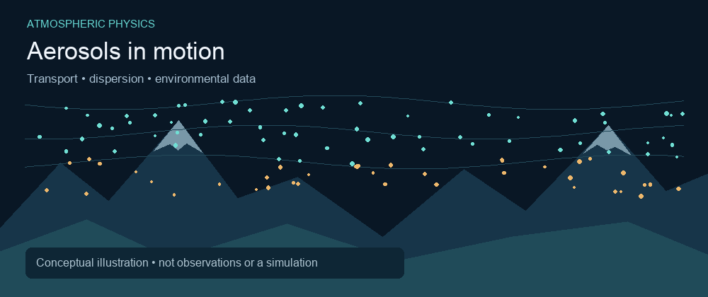

  

  <a href="https://scholar.google.com/citations?user=mOe4kq4AAAAJ&amp;hl=en">Google Scholar</a> ·
  <a href="https://www.linkedin.com/in/shyam-kuikel-10429b41a/">LinkedIn</a> ·
  <a href="https://doi.org/10.3126/hp.v14i1.85762">Publication</a> ·
  <a href="mailto:lekiuk777@gmail.com">Email</a>

## Introduction

I'm Shyam, a physics researcher and educator in Nepal working on **atmospheric physics, air-quality modeling, and computational methods**. My research interests connect aerosol observations and meteorological data with statistical modeling, machine learning, and deep learning to study air pollution and PM₂.₅ variability.

I hold an **M.Sc. in Physics from Tribhuvan University**, with a major in Advanced Solid State Physics. My current research focuses on environmental and atmospheric applications of data analysis.

  

Conceptual illustration of aerosol transport over a mountain valley. Original programmatic animation; not observational data or a physical simulation.

## What I work on

| Atmospheric science | Statistical modeling | Machine learning |
| --- | --- | --- |
| Aerosol optical properties and seasonal variability | Nonlinear and delayed meteorological associations with PM₂.₅ | ML and deep-learning approaches to PM₂.₅ prediction |
| Air quality and environmental monitoring | DLNM, CCM, regression, and time-series analysis | Review of CNN–LSTM architectures and spatiotemporal forecasting methods |

## Featured project · PM₂.₅ Prediction

**Investigating how meteorology relates to particulate air pollution.**

My [PM25-Prediction repository](https://github.com/shyamkuikel/PM25-Prediction) currently includes an **R workflow using distributed lag nonlinear models (DLNM)** to analyze station-specific temperature–PM₂.₅ associations. The workflow considers lagged effects and adjusts for meteorological covariates and temporal patterns.

The broader research direction includes statistical, machine-learning, and deep-learning approaches to air-quality forecasting.

[Explore the research code →](https://github.com/shyamkuikel/PM25-Prediction)

## Research highlights

- **Aerosol optical properties:** Published research on seasonal aerosol dynamics over Pokhara Valley, Central Nepal.
- **Meteorology and PM₂.₅:** Ongoing work with DLNM and CCM to investigate environmental relationships.
- **Deep-learning literature:** Working on a systematic review of CNN–LSTM models for PM₂.₅ prediction and estimation, from basic architectures to advanced spatiotemporal frameworks.

## Publication

**Kuikel, S., & Pandey, S. (2026).** Characterization of aerosol optical properties and their seasonal dynamics over Pokhara Valley, Central Nepal. *Himalayan Physics, 14*(1).  
[Read the paper · DOI: 10.3126/hp.v14i1.85762](https://doi.org/10.3126/hp.v14i1.85762)

## Technical toolkit

**Programming:** Python · R · C++ · FORTRAN  
**Analysis:** Statistical modeling · Regression and correlation · Time-series analysis · DLNM · CCM  
**Scientific tools:** Mathematica · Gnuplot · XMGrace · LaTeX

<b>Education and teaching</b>

- **M.Sc. in Physics (2015–2017)** — Central Department of Physics, Tribhuvan University, Nepal. Major: Advanced Solid State Physics.
- **B.Sc. in Physics (2011–2014)** — Prithivi Narayan Campus, Tribhuvan University, Nepal.
- Experience teaching physics to Grades 11 and 12 across schools in Nepal.
- Participated in the Southampton–IUCAA Training for Astronomical Research and Education (2018) and the Nepal Physical Society School of Physics Pedagogy (2022).

## Research collaboration

I'm interested in collaborations in **atmospheric science, air quality, environmental modeling, and computational physics**, especially projects connecting physical understanding with statistical and machine-learning methods.

[Connect on LinkedIn](https://www.linkedin.com/in/shyam-kuikel-10429b41a/) · [Explore my publications](https://scholar.google.com/citations?user=mOe4kq4AAAAJ&hl=en)
